# GuardX | Raspberry Pi 센싱·화재 판단·장치 제어

GuardX는 지능형 CCTV, 센서 노드, 판단 서버, 액추에이터 노드와 Windows VMS를 연결한 멀티채널 안전·관제 시스템입니다. 카메라의 WiseAI 메타데이터를 활용해 채널 간 객체 ID를 연결하고, 방문·체류·이동 흐름을 분석하며, 화재·혼잡·비상 이벤트를 MQTT로 전달해 현장 장치를 제어합니다.

> **이 저장소의 범위** GuardX의 Raspberry Pi 노드 세 대 중 **A의 센서 입력, B의 화재 판단·메시지 송수신, C의 장치 출력**에 해당하는 코드를 분리했습니다. A/C의 Linux 커널 드라이버 7종과 B의 센서 메시지 파싱, 화재 판정, 액추에이터 명령 생성·MQTT 발행 코드를 담았습니다. 관제·DB·인증·다중 구역 연동은 포함하지 않습니다.


`센서 입력` → `MQTT 수신` → `화재 판정` → `MQTT 명령 발행` → `액추에이터 구동`

---

## 목차

- [개요](#개요)
- [시스템 구조](#시스템-구조)
- [RPi B 화재 판단과 메시지 흐름](#rpi-b-화재-판단과-메시지-흐름)
- [RPi A/C 장치 드라이버 핵심 구현](#rpi-ac-장치-드라이버-핵심-구현)
- [빌드 환경](#빌드-환경)
- [빌드 및 적용](#빌드-및-적용)
- [디렉토리 구조](#디렉토리-구조)
- [하드웨어 연결](#하드웨어-연결)
- [검증 상태와 알려진 제약](#검증-상태와-알려진-제약)

---

## 개요

GuardX의 디바이스 경로를 **센싱(A) → 판단·명령 생성(B) → 구동(C)** 순서로 보여준다. B는 받은 데이터를 그대로 넘기는 중계기가 아니다. 센서값의 유효성을 확인하고 여러 입력을 결합해 화재를 판정한 뒤, 자기 명의의 액추에이터 명령을 만들어 C에 발행한다.

| 노드 | 이 저장소에 포함된 코드 | 하는 일 |
|------|------------------------|---------|
| **RPi A · 센서** | [`sensor-drivers/`](sensor-drivers/) | SPI·I²C·GPIO 센서값을 `/dev/rpia_*`로 제공 |
| **RPi B · 판단/중계** | [`decision-node/`](decision-node/) | 센서 JSON 수신·파싱, 화재 점수 및 연속 확인, C용 명령 생성·MQTT 발행 |
| **RPi C · 액추에이터** | [`actuator-drivers/`](actuator-drivers/) | 명령에 따라 제어할 서보·펌프·스텝모터를 `/dev/rpic_*`로 제공 |

이 저장소에는 A의 센서값 발행 앱과 C의 명령 수신 앱이 없다. 따라서 **A→B→C 전체를 이 저장소만으로 바로 실행할 수는 없다.** B의 실행 경로는 [아래 절](#rpi-b-화재-판단과-메시지-흐름)에서 별도로 확인할 수 있다.

| 노드 | 하드웨어 | 커널 모듈 | 역할 |
|------|----------|-----------|------|
| A | MCP3008 | [`rpia_adc`](sensor-drivers/src/rpia_adc.c) | CH0 불꽃·CH1 가스 아날로그 입력을 10비트 원시값으로 읽기 |
| A | SHT30 | [`rpia_temphum`](sensor-drivers/src/rpia_temphum.c) | 온도·습도 측정 |
| A | MLX90614 | [`rpia_irtemp`](sensor-drivers/src/rpia_irtemp.c) | 주변·대상 온도 측정 |
| A | GPIO 버튼 | [`rpia_button`](sensor-drivers/src/rpia_button.c) | 눌림 이벤트를 IRQ로 감지 |
| C | PCA9685 | [`rpic_pca9685`](actuator-drivers/src/rpic_pca9685.c) | 50Hz PWM으로 서보 각도 제어 |
| C | HG7881 | [`rpic_pump`](actuator-drivers/src/rpic_pump.c) | GPIO 두 핀으로 펌프 구동 |
| C | 28BYJ-48·ULN2003 | [`rpic_stepper`](actuator-drivers/src/rpic_stepper.c) | 하프스텝 회전과 방향별 리밋 감지 |

RPi B의 [`decision.c`](decision-node/src/decision.c)는 불꽃·가스·온습도·적외선 온도를 융합해 화재를 판정한다. [`sensor_parser.c`](decision-node/src/sensor_parser.c)는 센서 JSON을 읽고, [`cmd_builder.c`](decision-node/src/cmd_builder.c)는 C 노드용 명령 JSON을 만든다.

**이 저장소에서 중점을 둔 부분**

1. **판단과 구동 분리** — B가 센서 데이터로 화재를 판정한 뒤 C에 새로운 명령을 발행한다.
2. **하드웨어 접근과 사용자 인터페이스 분리** — A/C 커널 모듈이 실제 버스·GPIO를 다루고, 사용자 공간에 문자 장치와 `read/write/ioctl` 인터페이스를 제공한다.
3. **보드의 장치 등록 방식 반영** — SPI ADC는 Device Tree 오버레이와 `spi_driver.probe()`로 연결한다.
4. **이벤트·구동 경계 처리** — 버튼은 IRQ와 디바운싱으로 눌림을 전달하고, 스텝모터는 이동 방향의 리밋 센서가 감지되면 정지한다.

---

## 시스템 구조

```mermaid
flowchart LR
    subgraph INPUT["RPi A · 센서 노드"]
        HW1["MCP3008 · SPI0/CE0<br/>SHT30 / MLX90614 · I²C1<br/>버튼 · GPIO23"]
        DRV1["rpia_adc / rpia_temphum<br/>rpia_irtemp / rpia_button"]
        DEV1["/dev/rpia_*"]
        HW1 --> DRV1 --> DEV1
    end
    subgraph DECISION["RPi B · 화재 판단/명령 노드"]
        IN["MQTT 센서 JSON 수신"] --> FUSION["유효 채널 확인<br/>가중 점수 · 연속 판정"] --> OUT["새 액추에이터 명령 생성<br/>MQTT 발행"]
    end
    subgraph OUTPUT["RPi C · 액추에이터 노드"]
        DEV2["/dev/rpic_*"]
        DRV2["rpic_pca9685 / rpic_pump<br/>rpic_stepper"]
        HW2["PCA9685 · I²C1<br/>HG7881 / ULN2003 · GPIO"]
        DEV2 --> DRV2 --> HW2
    end
    DEV1 -. "A 송신 앱 미포함" .-> IN
    OUT -. "C 수신 앱 미포함" .-> DEV2
```



각 모듈의 데이터 구조와 `ioctl` 명령은 [센서 헤더](sensor-drivers/include/rpia_adc.h)와 [액추에이터 헤더](actuator-drivers/include/rpic_stepper.h)처럼 해당 폴더의 `include/`에 정의했다.

---

## RPi B 화재 판단과 메시지 흐름

| 단계 | 처리 | 코드 |
|------|------|------|
| A → B 수신 | 로컬 브로커의 `guardx/sensor/+` 구독, 센서 JSON 파싱 | [`mqtt_bus.c`](decision-node/src/mqtt_bus.c), [`sensor_parser.c`](decision-node/src/sensor_parser.c) |
| B 내부 판단 | 유효 센서 확인, 가중 점수 계산, 연속 입력으로 화재 확정 | [`decision.c`](decision-node/src/decision.c) |
| B → C 발행 | 화재 확정 시 서보·셔터·펌프 명령을 새 JSON으로 생성해 `guardx/actuator/rpic`에 발행 | [`cmd_builder.c`](decision-node/src/cmd_builder.c), [`main.c`](decision-node/src/main.c) |

원본 RPi B의 판단 코어를 유지했다. 가스·불꽃·온도·습도·적외선 온도 채널의 유효 여부와 가중치를 반영해 점수를 만들고, 임계값을 넘는 입력이 연속으로 들어와야 `NORMAL → FIRE`로 전이한다. 불꽃과 적외선 온도가 함께 높을 때의 교차 확인 경로도 있다. 화재 상태에서는 자동으로 정상 상태로 되돌리지 않으며, 원본 코어는 수동 해제 준비 상태를 별도로 관리한다. 기본 임계값은 **프로토타입 설정값**이며 실제 안전 설비에 적용하려면 센서 보정과 현장 검증이 필요하다.

공개용 [`main.c`](decision-node/src/main.c)는 **단일 센서 노드 `rpia`/액추에이터 노드 `rpic`** 경로만 보여준다. 화재가 확정되면 서보 각도 90, 셔터 닫기, 펌프 켜기 명령을 만든다. 이 각도와 동작 순서는 실기구와 연결해 검증한 값이 아니다. 기본 실행은 표준입력 JSON을 읽고 결과를 출력하는 **dry-run**이며, `--mqtt`를 지정해야 `127.0.0.1:1883` 브로커에서 `guardx/sensor/+`를 구독하고 `guardx/actuator/rpic`에 발행한다. 브로커 설정, 인증, 원격 접속 정보는 이 저장소에 없다.

```bash
# RPi B · libmosquitto 개발 패키지 설치 후
make -C decision-node
./decision-node/rpib-decision          # 표준입력 기반 dry-run
./decision-node/rpib-decision --mqtt   # 로컬 브로커와 실제 메시지 송수신
```

예시 센서 입력은 `seq`, `gas`/`spark`/`temphum`/`irtemp` 유효 플래그와 `gas_raw`, `spark_raw`, `temperature`, `humidity`, `irtemp_ambient`, `irtemp_object` 값을 가진 JSON이다. 원본 파서는 경량 문자열 파서이므로 입력 형식이 통제되는 개발 환경에서만 사용해야 한다.

---

## RPi A/C 장치 드라이버 핵심 구현

### MCP3008: Device Tree와 SPI 드라이버

MCP3008 한 개의 CH0·CH1을 각각 불꽃·가스 입력으로 사용한다. [오버레이](sensor-drivers/rpia-adc-overlay.dts)가 SPI0/CE0 장치를 선언하면 [`rpia_adc.c`](sensor-drivers/src/rpia_adc.c)의 `probe()`가 바인딩되고 `/dev/rpia_adc`를 만든다. 측정은 `spi_sync()`로 수행하며, 두 채널의 0~1023 원시값을 한 번의 `read()`로 반환한다. 농도나 임계값 판단은 드라이버 밖에서 처리한다.

```c
ret = spi_sync(adc_spi, &m);
if (ret < 0)
    return ret;
```

원본 프로젝트에서는 사용하던 커널의 SPI API 변경 때문에 직접 컨트롤러를 찾는 방식에서 오버레이·`probe()` 방식으로 바꿨다. 이 분리본의 `compatible` 문자열은 `example,rpia-adc`로 바꿨고, 오버레이와 드라이버 양쪽에 동일하게 적용했다.

### SHT30·MLX90614: 정수 기반 센서값

SHT30은 온도·습도, MLX90614는 주변·대상 온도를 읽는다. 커널에서 부동소수점 대신 0.1 단위 정수를 사용하므로 `235`는 23.5℃를 뜻한다. MLX90614는 SMBus 읽기와 PEC 검증을 사용한다. 값의 구조는 [`rpia_temphum.h`](sensor-drivers/include/rpia_temphum.h), [`rpia_irtemp.h`](sensor-drivers/include/rpia_irtemp.h)에 있다.

### 버튼: IRQ → 디바운싱 → poll

GPIO23의 하강 에지 IRQ를 받아 디바운싱 타이머를 갱신한다. 유효한 눌림은 카운터에 쌓고 `wake_up_interruptible()`로 `poll()` 대기자를 깨운다. 사용자 공간은 `read()`로 누적 횟수를 가져갈 수 있다.

```c
spin_lock_irqsave(&button_lock, flags);
press_count++;
spin_unlock_irqrestore(&button_lock, flags);
wake_up_interruptible(&button_waitq);
```

구현: [`rpia_button.c`](sensor-drivers/src/rpia_button.c)

### 스텝모터: 비동기 구동과 리밋 정지

`write()`가 회전 방향을 설정하면 커널 스레드가 8상 하프스텝 순서를 반복한다. CW 리밋(GPIO17)이나 CCW 리밋(GPIO27)이 감지되면 해당 방향의 구동을 멈추고, 반대 방향 이동은 허용한다. IRQ 뒤에는 다중 표본으로 접점 흔들림을 다시 확인한다.

```c
WRITE_ONCE(direction, 0);
wake_up_interruptible(&stepper_wq);
```

구현: [`rpic_stepper.c`](actuator-drivers/src/rpic_stepper.c)

---

## 빌드 환경

| 항목 | 요구사항 |
|------|----------|
| 대상 | Raspberry Pi 4 |
| 커널 빌드 | 실행 중인 커널과 일치하는 헤더·빌드 도구 |
| 버스 설정 | 센서 노드 SPI0·I²C1, 액추에이터 노드 I²C1 |
| 오버레이 컴파일 | `dtc` |
| RPi B 실행 | C11 컴파일러, `libmosquitto` 개발 헤더·라이브러리, 로컬 MQTT 브로커(`--mqtt` 모드) |
| 전원 | 센서 3.3V, 서보·모터 별도 구동 전원 및 공통 GND |

커널 모듈은 대상 보드의 커널 헤더에 의존한다. 이 저장소에는 사전 빌드된 `.ko`를 넣지 않았다.

---

## 빌드 및 적용

> **[Raspberry Pi]** A/C 커널 모듈은 해당 보드에서 각각 빌드한다. B 사용자 공간 프로그램의 빌드·실행은 [RPi B 절](#rpi-b-화재-판단과-메시지-흐름)에 있다. 아래 명령은 저장소 루트 기준이다.

```bash
# 센서 노드
make -C sensor-drivers

# 액추에이터 노드
make -C actuator-drivers
```

ADC는 오버레이를 별도로 컴파일해 부팅 시 적용해야 한다.

```bash
# 센서 노드 · 저장소 루트
dtc -@ -I dts -O dtb \
  -o sensor-drivers/rpia-adc.dtbo \
  sensor-drivers/rpia-adc-overlay.dts
```

대상 OS의 오버레이 경로에 `rpia-adc.dtbo`를 설치하고 부팅 설정에 `dtoverlay=rpia-adc`를 추가한 뒤 재부팅한다. 경로와 설정 파일은 OS 버전에 따라 확인해야 한다. SPI0/CE0를 점유하는 다른 오버레이가 있으면 중복을 먼저 해소한다.

하드웨어를 연결하지 않은 상태에서 액추에이터 명령 처리 경로만 확인하려면 모듈의 `simulate=1` 옵션을 사용할 수 있다. 예를 들어 [펌프 드라이버](actuator-drivers/src/rpic_pump.c)는 시뮬레이션 모드에서 GPIO 대신 로그를 남긴다.

```bash
# 액추에이터 노드 · 저장소 루트
sudo insmod actuator-drivers/rpic_pump.ko simulate=1
ls -l /dev/rpic_pump
sudo rmmod rpic_pump
```

이 옵션은 하드웨어 접근을 생략하므로 펌프의 실물 구동을 검증하지 않는다.

---

## 디렉토리 구조

```text
.
├── sensor-drivers/
│   ├── src/                  # MCP3008 · SHT30 · MLX90614 · 버튼
│   ├── include/              # 센서 데이터 구조와 ioctl 정의
│   ├── rpia-adc-overlay.dts   # SPI0/CE0의 MCP3008 장치 선언
│   └── Makefile
├── decision-node/
│   ├── src/                  # 센서 파싱 · 화재 판단 · 명령 생성 · 공개용 MQTT 어댑터
│   ├── include/              # 센서/판단/메시지 구조와 최소 프로토콜
│   └── Makefile
├── actuator-drivers/
│   ├── src/                  # PCA9685 · 펌프 · 스텝모터
│   ├── include/              # 제어 명령과 상태 구조
│   └── Makefile
└── README.md
```

---

## 하드웨어 연결

**BCM GPIO 번호 기준.** 괄호 안은 Raspberry Pi 헤더의 물리 핀 번호다.

| 센서 노드 | 연결 | 참고 |
|-----------|------|------|
| MCP3008 | MOSI GPIO10(19), MISO GPIO9(21), SCLK GPIO11(23), CE0 GPIO8(24) | CH0=불꽃 AO, CH1=가스 AO |
| SHT30 | SDA GPIO2(3), SCL GPIO3(5) | I²C1, 주소 `0x44` |
| MLX90614 | SDA GPIO2(3), SCL GPIO3(5) | I²C1, 주소 `0x5A` |
| 버튼 | GPIO23(16) ↔ GND | 내부 풀업, 누르면 LOW |
| 공통 | 3.3V(1), GND(6) | 센서 전원과 공통 접지 |

| 액추에이터 노드 | 연결 | 참고 |
|-----------------|------|------|
| PCA9685 | I²C1, 주소 `0x40` | 사용 중인 서보 채널 CH0, 50Hz |
| HG7881 | IA GPIO23, IB GPIO24 | 펌프 구동 입력 |
| ULN2003 | IN1~4 GPIO5/6/16/26 | 28BYJ-48 하프스텝 |
| 리밋 센서 | CW GPIO17, CCW GPIO27 | 풀업, LOW 감지 |

서보 전원은 별도 5V 공급을 사용하고 Raspberry Pi와 GND를 공유한다. 펌프와 스텝모터도 GPIO에 직접 연결하지 않고 구동 회로를 거친다.

---

## 검증 상태와 알려진 제약

- 원본 프로젝트 기록에는 센서별 측정과 액추에이터 단독 시험이 있다. **이 분리본 자체는 대상 Raspberry Pi 커널에서 재빌드·실물 재시험하지 않았다.** 공개 전에 각 보드에서 컴파일, 장치 등록, 실제 입출력을 다시 확인해야 한다.
- 원본에서 ADC 값이 0으로 고정됐던 사례는 SPI 활성화 설정과 SPI0 오버레이 설정의 중복이 원인이었다. 값이 나오지 않으면 배선뿐 아니라 부팅 설정, 오버레이 적용, `probe()` 로그를 함께 확인해야 한다.
- GPIO 번호와 커널 API는 보드·커널 버전에 영향을 받는다. 특히 버튼 드라이버는 원본 보드의 GPIO 칩 기준 번호를 사용하므로 다른 환경에서는 재확인이 필요하다.
- 팬·사운드 출력, A/C 사용자 공간 앱, 원본 B의 DB·관제·인증·다중 구역 설정은 포함하지 않았다. 이 저장소의 B 실행 파일은 데이터 흐름을 보여주는 축약본이며, 화재 대응 시스템으로 배포하거나 실제 설비를 바로 구동할 수 있는 완성품이 아니다.
